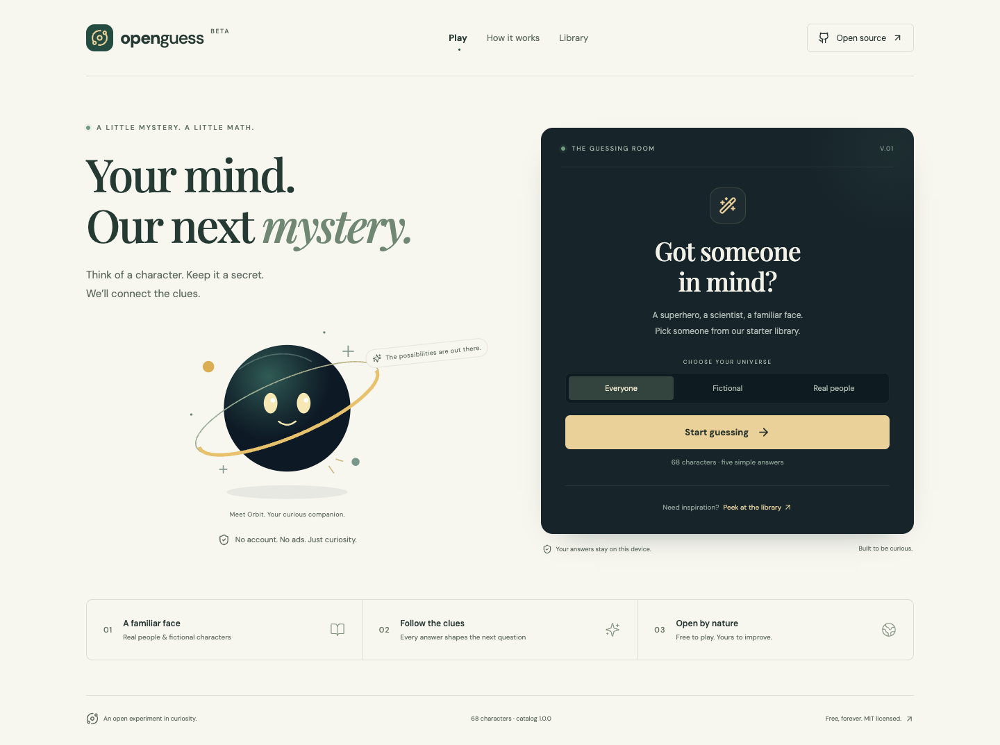

# OpenGuess

An original, free, open-source character guessing game. Think of someone in the supported catalog, answer five-choice questions, and watch OpenGuess narrow its candidates using Bayesian updates and information gain.

Version 0.1.0 is a starter release, not a world-scale knowledge database. It can guess only the people and fictional characters listed in its catalog. Uncertain answers and unknown characters can produce an inconclusive result.

[Play OpenGuess](https://mk-knight23.github.io/openguess/) · [Research](docs/research/akinator.md) · [Verification](docs/verification.md) · [Roadmap](docs/roadmap.md)



The first edition contains **68 characters and 60 questions**. The demo link requires the GitHub Pages deployment to finish.

## Run locally

Use Node.js **22.19 or later** and npm. CI uses Node.js 24.

```sh
npm ci
npm run dev
```

Open the local address printed by the development server.

```sh
npm test
npm run typecheck
npm run build
npm run preview
npm run test:e2e
```

The production build is in `dist/` and can be hosted as static files. Choose a host that supports your traffic and budget; the application requires no server-side gameplay service.

For browser tests, install Chromium with `npx playwright install chromium`, or set `BROWSER_EXECUTABLE` to an existing Chrome-family executable. The smoke script starts its own preview server on port 4175 and writes reports/screenshots under `/tmp/openguess-qa` (override with `QA_OUTPUT`). For Volta users, this repository pins Node.js 24.19.0 without changing the global default. GitHub Pages builds use `DEPLOY_BASE=/openguess/`; other deployments default to `/`.

## What v1 does

- Five answers: yes, probably, don't know, probably not, and no.
- Undo, restart, confirmation and rejection of guesses.
- A visible supported catalog and optional inference explanations.
- Local browser preferences and statistics.
- Contribution proposals exported as JSON for human review.

No accounts, advertising, subscriptions, paid APIs or remote learning are required. Browser storage is local to the browser and may be cleared by its owner. Exporting a proposal does not add it to anyone's catalog; submit it through a reviewed contribution.

## How it works

A pure client-side engine starts with candidate weights, updates them from answers, and chooses questions by expected entropy reduction. A “don't know” answer supplies no evidence. The probability shown describes the model's relative candidate weights, not independently calibrated confidence that a real person has been identified.

See [architecture](docs/architecture.md), [scaling](docs/scaling.md), [roadmap](docs/roadmap.md), [contributing](CONTRIBUTING.md), and [security](SECURITY.md).

## Research and originality

Akinator inspired the broad game format. REA inspection of its public site encountered a Cloudflare challenge, so live gameplay, private endpoints and its proprietary algorithm were not observed. OpenGuess's inference model, interface and starter catalog are independently authored. It does not call Akinator services or include its source, artwork or database. See the [research notes](docs/research/akinator.md).

The public repository is [mk-knight23/openguess](https://github.com/mk-knight23/openguess). Software is free under the [MIT license](LICENSE); bundled dependencies retain their [notices](THIRD_PARTY_NOTICES.md). Free software does not imply unlimited free hosting.
